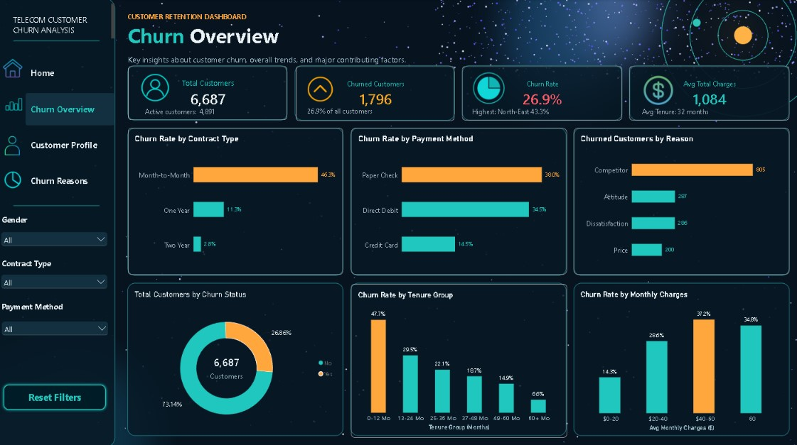
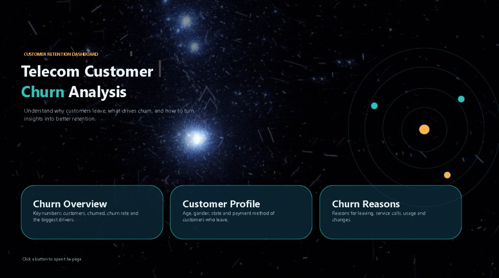
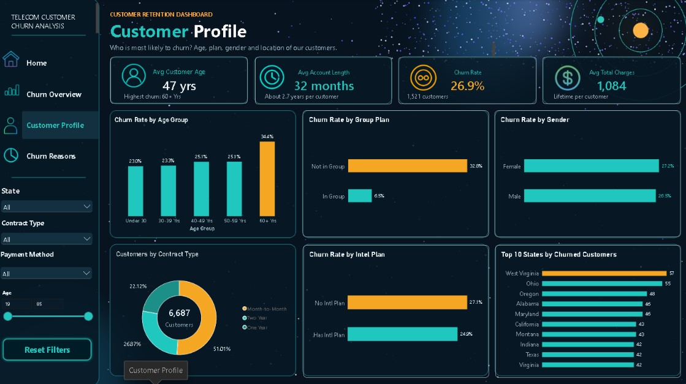
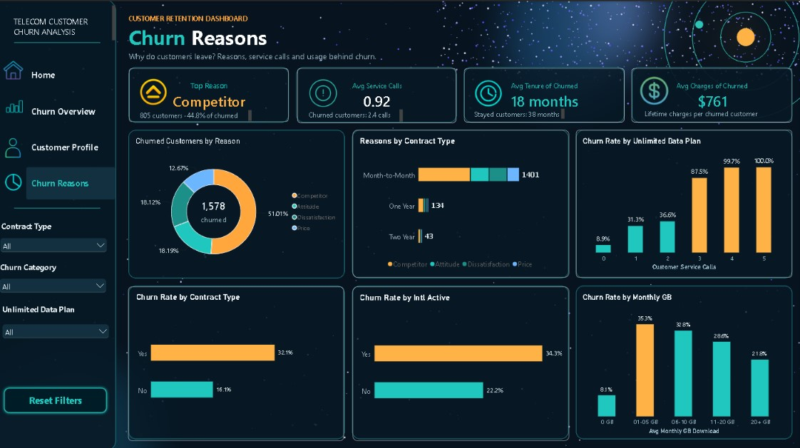

# Telecom Customer Churn Dashboard | Power BI

An interactive Power BI dashboard that explores who leaves a telecom service, when they leave, and why.

## Key Findings

- About 27% of customers churned, but the risk is not evenly spread.
- Month-to-Month contracts churn at 46.3%, versus 2.8% for two-year contracts.
- The first year is the riskiest period, with 47.7% churn. It drops to 6.6% after five years.
- Churn jumps from 36.6% to 87.5% between the second and third support call.
- Customers on a group plan churn at 6.5%, versus 32.8% for everyone else.
- Competitors are the most common recorded reason for leaving.

## Dashboard Pages

| Page | Question it answers |
|---|---|
| Home | Landing page and navigation |
| Churn Overview | How big is the churn problem? |
| Customer Profile | Who is most likely to churn? |
| Churn Reasons | Why do customers leave? |

## Screenshots

### Home

### Customer Profile

### Churn Reasons

## Tools and Techniques

- Power BI for interactive data visualization
- Power Query for data cleaning and preparation
- DAX for measures and KPIs
- Interactive slicers, bookmarks and page navigation
- Custom dashboard design and data storytelling

## Files

- `Telecom_Churn_Dashboard.pbix`: the Power BI report (open it with Power BI Desktop)
- `Telecom_Churn_Dashboard.pdf`: a PDF export of all pages
- `screenshots/`: images of each dashboard page

## Demo

[Watch the walkthrough on LinkedIn](PUT-YOUR-LINKEDIN-POST-LINK-HERE)

## Author

**Ibrahim Salim**
[GitHub](https://github.com/IbrahimSalim925)
